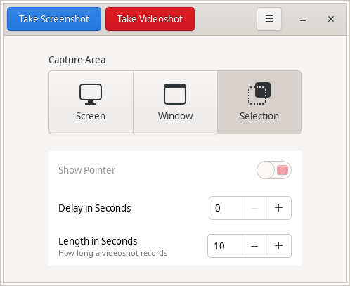
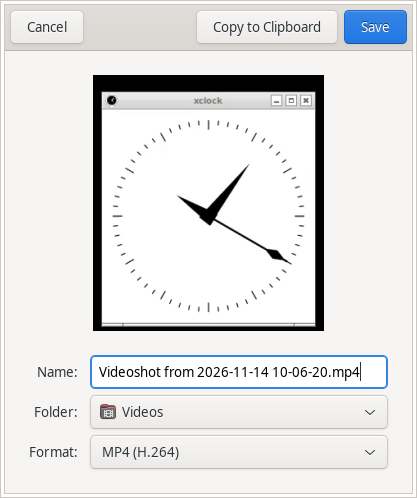

Videoshot
=========

Videoshot takes screenshots and short video clips ("videoshots") of the whole
screen, the focused window, or an area you select. It is a fork of GNOME
Screenshot 41.0 as shipped by Linux Mint (`gnome-screenshot 41.0+mint2`), with
recording added.



## What it adds to the Mint screenshot tool

- A red **Take Videoshot** button next to **Take Screenshot**.
- A **Length in Seconds** row under **Delay in Seconds**.
- A result window for videoshots, like the one for screenshots: preview,
  **Name**, **Folder**, **Format**, **Copy to Clipboard** and **Save**.
- Output formats MP4 (H.264), WebM (VP9), Matroska (H.264) and animated GIF.
  Pick the default under menu → **Preferences**, or change it per clip in the
  result window. The file name ending follows the format.
- File names say what was made: `Screenshot from <date>.png` or
  `Videoshot from <date>.mp4`.

A recording stops by itself after the set length. To stop early, click the
record icon in the panel, launch Videoshot again, or run `videoshot --stop`.
What was recorded so far is kept.

**Copy to Clipboard** puts the video file on the clipboard, the way a file
manager does. Paste it into a folder, a chat or a document.



## Requirements

- An X11 session (Cinnamon, MATE, Xfce) or a Wayland session with a desktop
  portal that shares the screen (KDE Plasma, GNOME).
- `ffmpeg` with libx264 and libvpx (the Mint/Ubuntu package has them).
- On Wayland also `gst-launch-1.0` with the PipeWire plugin and the "base"
  and "good" plugins.
- To build: GLib, GTK 3, libhandy 1.5 or newer, X11, Xext, Xfixes, meson.

```sh
sudo apt install ffmpeg meson libgtk-3-dev libhandy-1-dev libx11-dev libxext-dev libxfixes-dev
```

For Wayland:

```sh
sudo apt install gstreamer1.0-tools gstreamer1.0-pipewire gstreamer1.0-plugins-good
```

## Wayland

On Wayland the desktop decides what a program may see. When you take a
videoshot, the desktop asks you which screen or window to share, and that is
what gets recorded. The Screen, Window and Selection buttons do not choose it
there. Screenshots go through the desktop too; it may ask for permission the
first time.

Tested on KDE Plasma 6. While a videoshot records, the desktop shows its own
screen sharing indicator. To stop early, run `videoshot --stop` or start
Videoshot again.

## Build and install

```sh
meson setup build --prefix="$HOME/.local"
ninja -C build
ninja -C build install
```

## Packages

Packaging for three package managers is in the tree:

| Package manager | Files | Built and tested on |
|---|---|---|
| apt (`.deb`) | [debian/](debian) | Ubuntu 24.04, the base of Linux Mint 22 |
| dnf (`.rpm`) | [packaging/rpm/videoshot.spec](packaging/rpm/videoshot.spec) | Fedora |
| pacman | [packaging/arch/PKGBUILD](packaging/arch/PKGBUILD) | Arch Linux |

`packaging/build-packages.sh` builds all three in clean containers (it needs
docker), installs each one there, records a clip in every format and puts the
packages in `dist/`.

Fedora's own ffmpeg has no libx264. Videoshot then records MP4 and Matroska
with libopenh264 instead.

Videoshot uses its own application ID (`com.royake.Videoshot`) and settings
schema, so it installs next to `gnome-screenshot` without touching it.

## Command line

```sh
videoshot --interactive                      # the dialog
videoshot --video --length 5                 # record the screen, then show the result window
videoshot --video --area --length 8 --file clip.gif
videoshot --video --window --include-pointer --length 10 --file win.mp4
videoshot --stop                             # end the running recording
```

All `gnome-screenshot` options still work. See `man videoshot`.

## Where it comes from

Videoshot is built on GNOME Screenshot by Jonathan Blandford, Emmanuele Bassi,
Cosimo Cecchi, Alexander Mikhaylenko and many others, with the changes Linux
Mint made to version 41.0. The git history keeps all of it. See
[AUTHORS.md](AUTHORS.md) and [NEWS](NEWS).

Notes on the code layout and on testing are in [AGENTS.md](AGENTS.md).

## Status

Version 0.1.0-beta1, a beta. Known gaps: no selection of an area by Videoshot
itself on Wayland, no countdown during the delay, and the new texts are in
English only.

## Support

If Videoshot is useful to you, you can support the work:

**[☕ Buy me a coffee](https://buymeacoffee.com/royake)**

Created and maintained by **Roy-Åke Martinsson** · [royake.com](https://royake.com)

## License

GPL-2.0-or-later, the same as GNOME Screenshot. See [COPYING](COPYING).
