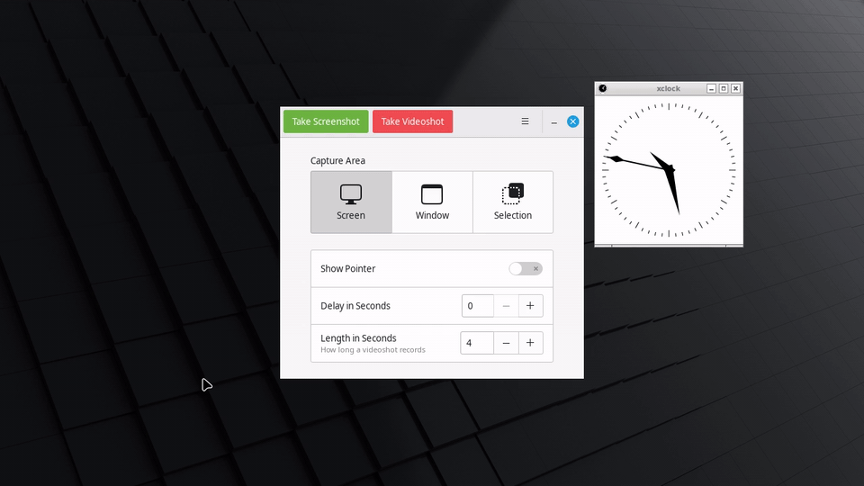

Videoshot
=========

**Make a video clip of your screen as easily as you take a screenshot.**

Sometimes a picture is not enough: a bug that only shows when you click, a
setting that is three menus deep, an animation, a quick "look, like this".
Videoshot is for those moments. Choose the screen, a window or drag out an
area, press **Take Videoshot**, and a few seconds later the clip is in front
of you, ready to save or to paste into a chat.

There is no project to set up, no timeline and nothing to learn. If you can
take a screenshot, you can take a videoshot. And it still takes screenshots.



## What you can do with it

- **Record what you point at.** The whole screen, the window in front, or an
  area you drag out with the mouse.
- **Keep it short.** Set the length in seconds and the recording ends by
  itself. Or stop it early; what was recorded so far is kept.
- **Check it before you send it.** The result window plays the clip in
  place when you click it.
- **Share it right away.** **Copy to Clipboard** puts the clip on the
  clipboard as a file. Paste it into a chat, a mail, a folder or a document.
- **Pick the format that fits.** MP4 and WebM for chats and the web, Matroska
  for keeping, animated GIF for places that take pictures only. Change it per
  clip in the result window; the file name ending follows.
- **Show or hide the pointer**, and set a delay to get a menu open first.
- **Use it from scripts and shortcuts.** Everything is on the command line
  too, see below.


## How it works

1. Open Videoshot and choose **Screen**, **Window** or **Selection**.
2. Set **Length in Seconds** and press the red **Take Videoshot** button.
   With **Selection** you now drag out the area.
3. The result window shows the clip. Click the play icon to watch it right
   there; click again to stop. Give it a **Name**, choose a **Folder** and a
   **Format**, then **Save** or **Copy to Clipboard**.

Files are named after what they are: `Screenshot from <date>.png` or
`Videoshot from <date>.mp4`. The default format is under menu →
**Preferences**.

A recording stops by itself after the set length. To stop early, click the
record icon in the panel, launch Videoshot again, or run `videoshot --stop`.
What was recorded so far is kept.


## Requirements

- An X11 session (Cinnamon, MATE, Xfce) or a Wayland session with a desktop
  portal that shares the screen (KDE Plasma, GNOME).
- `ffmpeg` with libx264 and libvpx (the Mint/Ubuntu package has them).
- On Wayland also `gst-launch-1.0` with the PipeWire plugin and the "base"
  and "good" plugins.
- To build: GLib, GTK 3, libhandy 1.5 or newer, X11, Xext, Xfixes, meson.

```sh
sudo apt install ffmpeg meson libgtk-3-dev libhandy-1-dev libx11-dev libxext-dev libxfixes-dev
```

For Wayland:

```sh
sudo apt install gstreamer1.0-tools gstreamer1.0-pipewire gstreamer1.0-plugins-good
```

## Wayland

On Wayland the desktop decides what a program may see. When you take a
videoshot, the desktop asks you which screen or window to share, and that is
what gets recorded. The Screen, Window and Selection buttons do not choose it
there. Screenshots go through the desktop too; it may ask for permission the
first time.

Tested on KDE Plasma 6. While a videoshot records, the desktop shows its own
screen sharing indicator. To stop early, run `videoshot --stop` or start
Videoshot again.

## Build and install

```sh
meson setup build --prefix="$HOME/.local"
ninja -C build
ninja -C build install
```

## Packages

Packaging for three package managers is in the tree:

| Package manager | Files | Built and tested on |
|---|---|---|
| apt (`.deb`) | [debian/](debian) | Ubuntu 24.04, the base of Linux Mint 22 |
| dnf (`.rpm`) | [packaging/rpm/videoshot.spec](packaging/rpm/videoshot.spec) | Fedora |
| pacman | [packaging/arch/PKGBUILD](packaging/arch/PKGBUILD) | Arch Linux |

`packaging/build-packages.sh` builds all three in clean containers (it needs
docker), installs each one there, records a clip in every format and puts the
packages in `dist/`.

Fedora's own ffmpeg has no libx264. Videoshot then records MP4 and Matroska
with libopenh264 instead.

Videoshot uses its own application ID (`com.royake.Videoshot`) and settings
schema, so it installs next to `gnome-screenshot` without touching it.

## Command line

```sh
videoshot --interactive                      # the dialog
videoshot --video --length 5                 # record the screen, then show the result window
videoshot --video --area --length 8 --file clip.gif
videoshot --video --window --include-pointer --length 10 --file win.mp4
videoshot --stop                             # end the running recording
```

All `gnome-screenshot` options still work. See `man videoshot`.

## Where it comes from

Videoshot is a fork of GNOME Screenshot 41.0 as shipped by Linux Mint
(`gnome-screenshot 41.0+mint2`), with recording added. It looks and works like
the screenshot tool you know from Mint.

It is built on GNOME Screenshot by Jonathan Blandford, Emmanuele Bassi,
Cosimo Cecchi, Alexander Mikhaylenko and many others, with the changes Linux
Mint made. The git history keeps all of it. See
[AUTHORS.md](AUTHORS.md) and [NEWS](NEWS).

Notes on the code layout and on testing are in [AGENTS.md](AGENTS.md).

## Status

Version 0.1.0-beta1, a beta. Known gaps: no selection of an area by Videoshot
itself on Wayland, no countdown during the delay, and the new texts are in
English only.

## Support

If Videoshot is useful to you, you can support the work:

**[☕ Buy me a coffee](https://buymeacoffee.com/royake)**

Created and maintained by **Roy-Åke Martinsson** · [royake.com](https://royake.com)

## License

GPL-2.0-or-later, the same as GNOME Screenshot. See [COPYING](COPYING).
